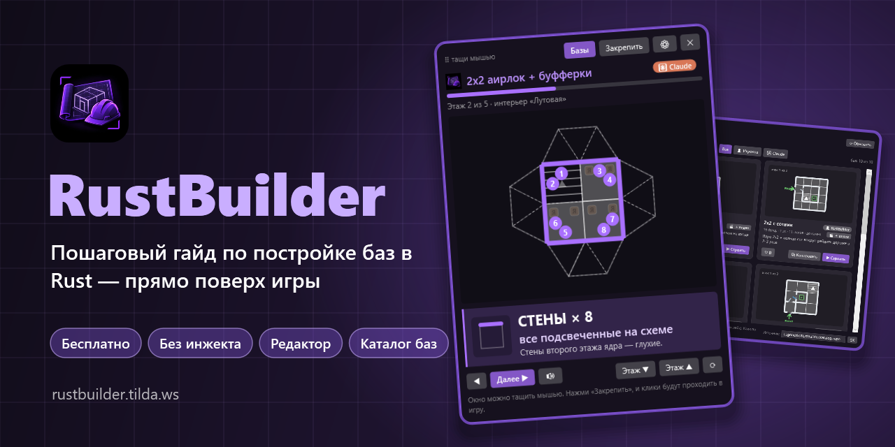
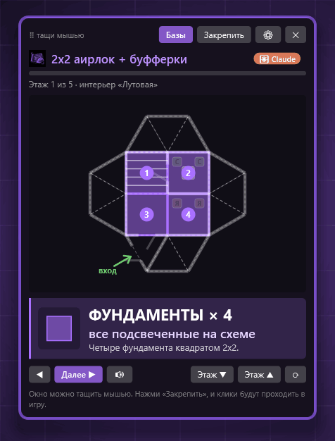
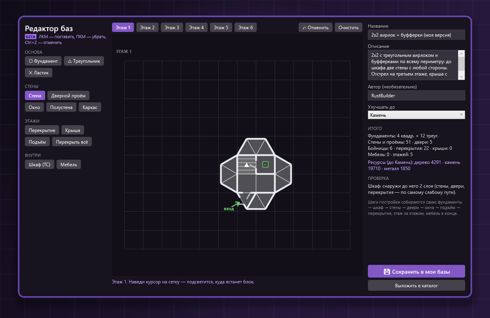
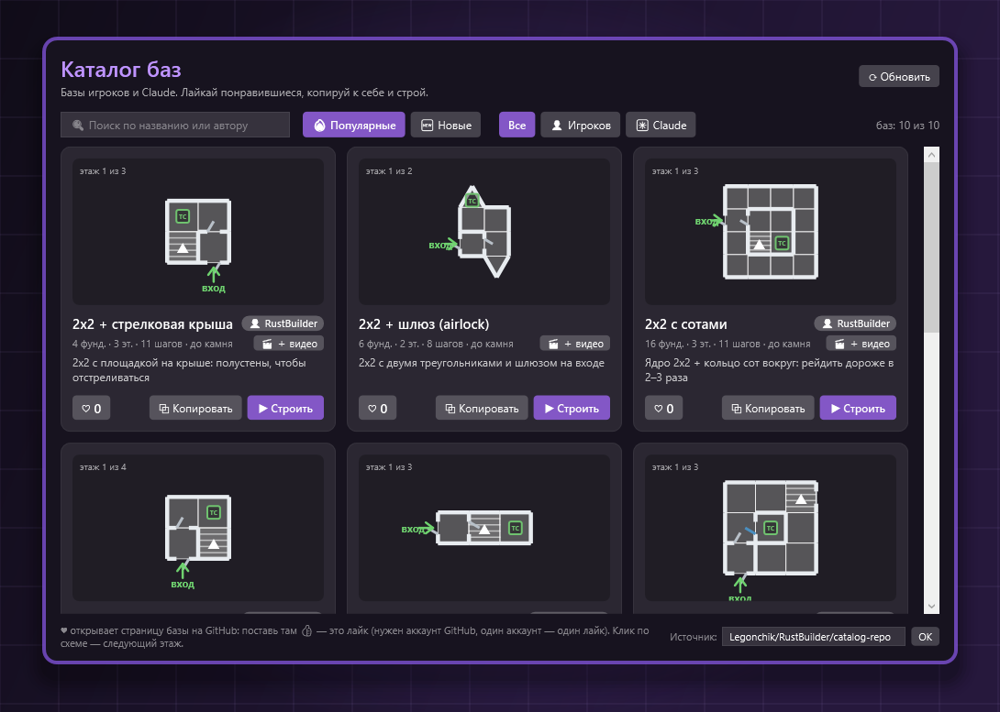
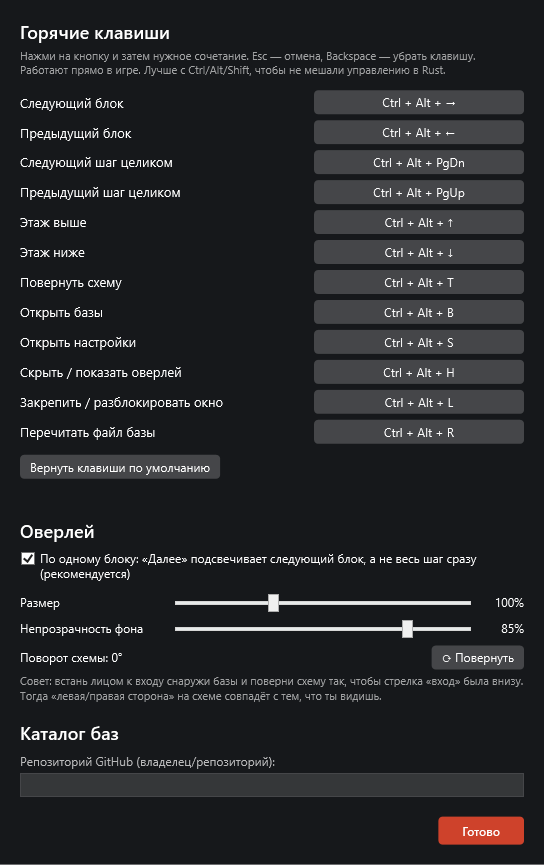

<p align="center">
  
</p>

<p align="center">
  <a href="../../releases/latest"></a>
  <a href="../../releases"></a>
  
  
  
</p>

<p align="center">
  <a href="../../releases/latest/download/RustBuilderSetup.exe"></a>
  &nbsp;
  <a href="../../releases/latest"></a>
</p>

<p align="center">
  🌐 <a href="https://legonchik.github.io/RustBuilder/"><b>Сайт</b></a> &nbsp;·&nbsp;
  📚 <a href="catalog-repo"><b>Каталог баз</b></a> &nbsp;·&nbsp;
  💬 <a href="../../issues"><b>Вопросы и идеи</b></a> &nbsp;·&nbsp;
  ❤ <a href="https://pay.cloudtips.ru/p/94c686ed"><b>Поддержать автора</b></a>
</p>

> [!IMPORTANT]
> **🆕 RustBuilder только вышел, и нам очень нужны ваши базы!**
> Каталог пока совсем маленький, и каждая база от игрока делает его лучше. Нарисуй свою в редакторе («Базы» → **✏ Создать базу**) и нажми **«Выложить»**. Она появится в каталоге у всех с твоим ником, а другие игроки смогут её лайкать и строить. Строишь базы давно? Тогда тем более ждём 🙌

<br>

<table>
<tr>
<td width="44%" align="center"></td>
<td>

### Строй по шагам, не сворачивая игру

Выбираешь базу, и RustBuilder прямо поверх Rust показывает, **какой блок ставить, на какую сторону и сколько ресурсов нужно**. Шаги листаешь горячими клавишами, не выходя из игры.

- 🔢 Все блоки шага пронумерованы и подписаны словами
- 🧱 Построенное закрашено, следующее — пунктиром
- 🧭 Стрелка «вход» и поворот схемы под твой обзор
- 💰 Ресурсы на шаг и на всю базу
- 🖱️ «Закрепить» — клики проходят прямо в игру

> ✅ **Без инжекта, и так будет всегда.** RustBuilder не читает память Rust, не подгружает DLL и не жмёт клавиши за тебя. Это обычное окно поверх игры, как оверлей Discord.

</td>
</tr>
</table>

## ✨ Что внутри

<table>
<tr>
<td width="50%" valign="top">

### ✏️ Редактор баз
Рисуешь базу мышкой по сетке, блоки цепляются друг к другу как в Rust: фундаменты и треугольники, стены, двери, окна с бойницами, каркасы с гаражной дверью, перекрытия, крыши-скаты, подъём, шкаф, мебель. Ресурсы, шаги постройки и число слоёв до шкафа считаются сами.



</td>
<td width="50%" valign="top">

### 🌐 Каталог баз игроков
Базы от игроков и Claude: ♡ лайки, сортировка по популярности, **⧉ Копировать** к себе и **▶ Строить** в один клик. Свою базу выкладываешь туда же прямо из редактора. К базам есть 🎬 видео-гайды, их проверяет модератор.



</td>
</tr>
<tr>
<td width="50%" valign="top">

### 📚 14 готовых баз
От соло 1x1 до клановой 4x4 с сотами. Все с отстрелом, у 2x2 есть буфферки или щупальца, у баз есть варианты интерьера: «Лутовая», «Крафт и плавка», «Для команды».


</td>
<td width="50%" valign="top">

### ⚙️ Под себя
Горячие клавиши работают прямо в игре и переназначаются. Можно поменять размер, прозрачность и цвет интерфейса, включить звуки и статус в Discord. Новые версии программа скачивает сама.



</td>
</tr>
</table>

## 🚀 Установка

1. **Скачай [установщик](../../releases/latest/download/RustBuilderSetup.exe)** (около 200 КБ). Он сам скачает последнюю версию, поставит её и сделает ярлыки. Можно и вручную: [ZIP-архив](../../releases/latest) распаковываешь в любую папку и запускаешь `RustBuilder.exe`.
2. В Rust включи режим **«Окно без рамки»** (Borderless). В полноэкранном режиме оверлей не виден.
3. Открой **«Базы»**, выбери базу и нажми **«Строить эту базу»**. Перетащи оверлей в удобное место и нажми **«Закрепить»**.

> Windows может сказать «Windows защитила ваш компьютер»: у программы нет платной цифровой подписи. Нажми **«Подробнее» → «Выполнить в любом случае»**.

💡 **Совет:** встань снаружи лицом ко входу и поверни схему (**Ctrl+Alt+T**), чтобы стрелка «вход» была внизу. Тогда «левая/правая сторона» в подсказках совпадёт с тем, что ты видишь.

<details>
<summary><b>⌨️ Горячие клавиши</b></summary>

| Клавиши | Действие |
|---|---|
| `Ctrl+Alt+→` / `Ctrl+Alt+←` | следующий / предыдущий блок |
| `Ctrl+Alt+PgDn` / `Ctrl+Alt+PgUp` | следующий / предыдущий шаг целиком |
| `Ctrl+Alt+↑` / `Ctrl+Alt+↓` | этаж выше / ниже |
| `Ctrl+Alt+T` | повернуть схему |
| `Ctrl+Alt+B` | открыть базы |
| `Ctrl+Alt+S` | настройки |
| `Ctrl+Alt+H` | скрыть / показать оверлей |
| `Ctrl+Alt+L` | закрепить / разблокировать окно |
| `Ctrl+Alt+R` | перечитать файл базы |

Все клавиши, размер и прозрачность оверлея меняются в **Настройках** (⚙).

</details>

## 🏠 Готовые базы

Все встроенные базы придумал Claude (ИИ), у них оранжевый значок **✳ Claude**. У баз игроков вместо него стоит **👤 ник** автора. Это не копии баз известных строителей.

| База | Для кого | Слоёв до шкафа |
|---|---|:---:|
| Соло 1x1 | самый быстрый старт | 1 |
| Стартер 2x1 | первый дом | 1 |
| 2x1 треугольный аирлок (вход слева / справа) | стандартный старт | 1 |
| Тришка (квадрат + 4 треугольника) | соло | 2 |
| 2x1 аирлок + буфферки | соло / дуо | 2 |
| 3x1 аирлок + 2 этаж | соло / дуо | 2 |
| 2x2 + аирлок + щупальца | соло / дуо | 2 |
| 2x2 трёхэтажная + щупальца | соло / дуо | 2 |
| 2x2 аирлок + буфферки | дуо / трио | 2 |
| 2x2 буфферки + стрелковая крыша | дуо | 2 |
| 2x2 с сотами | дуо | 2 |
| 3x3 для трио | 2–3 игрока | 2 |
| Клан 4x4 с сотами | клан | 3 |

<details>
<summary><b>Как считаются слои и по каким правилам собраны базы</b></summary>

«Слоёв до шкафа» — сколько минимум стен, дверей и перекрытий надо сломать снаружи, чтобы добраться до шкафа, по самому слабому пути (с учётом крыши и шахты подъёма). Генератор баз проверяет это сам.

- **Бойницы — только там, где есть внешний слой** (буфферки, щупальца, соты). В стартерах стены глухие: каждое окно — лишнее слабое место. Пустых окон без бойницы нет нигде.
- **Этаж с бойницами отделён от лута дверью:** подъём на нём стоит в будке со стенами и дверью.
- **Выход на крышу — будка с дверью и потолком**, а не открытая дыра над подъёмом.
- **Подъём — в тупиковом углу:** не в аирлоке, не на пути от входа к шкафу. Подъёмы стоят друг над другом.

</details>

## 🧩 Свои базы и каталог

**Проект только запустился, поэтому каждая выложенная база на счету.** С первых авторов каталог и начнётся.

- **Нарисовать:** «Базы» → **✏ Создать базу** (или **✏ Изменить**, чтобы взять готовую за основу). ЛКМ ставит блок, ПКМ убирает, Ctrl+Z отменяет.
- **Выложить в каталог:** «Базы» → своя база → **Выложить**. В первый раз программа попросит придумать ник, он будет стоять у базы. Откроется GitHub с готовым файлом: нажми *Propose changes* и *Create pull request*. База проверяется автоматически и попадает в каталог после одобрения.
- **Ник — только твой:** первая принятая база закрепляет ник за твоим аккаунтом GitHub. Больше никто не сможет выложить базу под ним, даже с похожими буквами (`0` вместо `o`, кириллица вместо латиницы). Менять и удалять базу может только её автор.
- **Взять из каталога:** «Базы» → **Каталог онлайн…**. Аккаунт для скачивания не нужен. Лайк — это 👍 на странице базы на GitHub (один аккаунт — один лайк).
- **Поделиться файлом:** база — это JSON. **Экспорт…** отправляет её другу, **Загрузить свою базу…** открывает чужую.

### 🎬 Видео-гайды

Кнопка **🎬** на карточке базы показывает видео, как её строить. Своё видео можно предложить там же. Правила жёсткие:
- только YouTube и Rutube;
- без мата, 18+, читов, казино, «бесплатных скинов» и скама;
- аккаунт GitHub старше 14 дней.

Робот проверяет заявку сразу, потом видео вручную смотрит модератор. Без одобрения в программу ничего не попадает.

<details>
<summary><b>Для модератора: как одобрять и убирать видео</b></summary>

Заявка — это форма issue `🎬 Видео-гайд к базе`. Workflow `.github/workflows/videos.yml` запускает `catalog-repo/scripts/videos.mjs`. Если хоть одно правило нарушено, заявка закрывается с объяснением. Иначе она получает метку `video-pending`.

- Поставь метку **`video-approved`**: робот ещё раз всё перепроверит, допишет видео в `catalog-repo/videos.json` и закроет заявку.
- Поставь метку **`video-removed`** на заявку, чтобы убрать видео. Жалобы приходят issue с меткой `video-report`, в них указан номер заявки.
- Нарушителя можно навсегда запретить: ник добавляется в `catalog-repo/video-banned.json`.
- Метки работают только от людей с правом записи в репозиторий. Программа повторно проверяет каждую ссылку и открывает только YouTube или Rutube, собирая адрес из ID видео.

Полный список автоматических проверок:
- ссылка только `https` на YouTube (`watch`, `youtu.be`, `shorts`) или Rutube, без сокращателей и редиректов;
- видео открывается: удалённые, приватные и закрытые для встраивания отклоняются;
- в названии, имени канала и описании нет мата, 18+, читов, казино, ставок, промокодов, розыгрышей, Telegram и Discord-ссылок. Маскировку вроде `х*й` или `c@sino` робот тоже ловит;
- в описании нет ссылок, длина до 300 символов, отмечены все 5 галочек;
- аккаунт старше 14 дней, на проверке не больше 3 заявок от одного человека, одно видео от автора на базу, без дублей.

</details>

<details>
<summary><b>Для автора проекта: как выдать или зарезервировать ник</b></summary>

Реестр ников лежит в `catalog-repo/nicknames.json`.
- **Новый ник** закрепляется автоматически: после принятия первой базы workflow `catalog.yml` записывает ник за тем, кто её прислал.
- **Выдать ник** (например, известному строителю): открой форму **[🔒 Выдать ник](../../issues/new?template=nick-grant.yml)**, впиши ник и логин GitHub, выбери «Выдать». Робот запишет его в реестр и закроет заявку.
- **Зарезервировать** — то же, но выбрать «Зарезервировать» и логин не указывать. Пока ник не выдан, его не сможет взять никто.
- **Освободить** — выбрать «Освободить ник».
- Форма срабатывает только от людей с правом записи в репозиторий, заявки остальных закрываются.
- Pull request с занятым ником, с правкой или удалением чужой базы не проходит проверку `Проверка ника автора`. Участников проекта проверка пропускает.

</details>

<details>
<summary><b>Формат файла базы</b></summary>

```jsonc
{
  "name": "Стартер 2x1",
  "description": "Быстрый первый дом",
  "tier": "stone",                       // twig | wood | stone | metal | hqm — до чего улучшать
  "pieces": [
    { "id": "f1", "type": "foundation", "x": 0, "y": 0 },          // квадрат на сетке
    { "id": "f2", "type": "foundation", "x": 1, "y": 0 },
    { "id": "t1", "type": "triangle", "on": "f1", "edge": "N" },   // треугольник к стороне квадрата
    { "id": "tc", "type": "tc", "on": "f2" },
    { "id": "w1", "type": "wall", "on": "f1", "edge": "W" },
    { "id": "d1", "type": "doorway", "on": "f1", "edge": "S",
      "door": "sheet", "lock": "code", "entrance": true },
    { "id": "s1", "type": "stairs", "on": "f2", "floor": 1 },
    { "id": "c1", "type": "floor", "on": "f1", "floor": 2 }        // перекрытие = пол 2-го этажа
  ],
  "steps": [
    { "text": "Поставь два фундамента.", "pieces": ["f1", "f2"] },
    { "text": "Шкаф.", "pieces": ["tc"] }
  ]
}
```

| Поле | Значения |
|---|---|
| `type` | `foundation`, `triangle`, `wall`, `doorway`, `window`, `halfwall`, `frame`, `floor`, `roof`, `stairs`, `tc` и мебель |
| `edge` | у квадрата `N` `E` `S` `W`, у треугольника `L` `R` (если смотреть от основания наружу). У `roof` — сторона свеса (куда скат идёт вниз), у треугольника ещё `B`. Квадрат можно не по сетке, а прикрепить к стороне блока: `{ "type": "foundation", "on": "t1", "edge": "L" }` |
| `floor` | этаж: 1 — первый. У `floor` это уровень, на котором лежит перекрытие |
| `door` | у `doorway`: `wood`, `sheet`, `armored`; у `frame`: `garage`, `double-wood`, `double-sheet`, `double-armored` |
| `lock` | `code`, `key` |
| `entrance` | `true` — на схеме будет стрелка «вход» |
| `embrasure` | у `window`: `horizontal` или `vertical` — горизонтальная или вертикальная бойница |
| `slot` | у мебели: угол клетки 0–3 |
| `interiors` | варианты интерьера: `[{ "name", "description", "pieces", "steps" }]`, мебель `box` `furnace` `workbench` `repair` `bag` `locker` |

Большие базы удобнее описывать кодом в генераторе [`tools/gen-bases.mjs`](tools/gen-bases.mjs). Он сам считает внешние стены и раскладывает блоки по шагам.

</details>

<details>
<summary><b>🛠 Сборка из исходников и структура проекта</b></summary>

Нужен [.NET 8 SDK](https://dotnet.microsoft.com/download/dotnet/8.0).

```bash
cd RustBuilder
dotnet build -c Release
```

```
RustBuilder/     приложение (C#, .NET 8, WPF)
  Builds/        встроенные базы
Loader/          маленький установщик RustBuilderSetup.exe
tools/           генератор баз
catalog-repo/    онлайн-каталог: базы, лайки, видео-гайды и их проверка
docs/            картинки для README
```

</details>

## 🗺 Планы

- [x] Визуальный редактор баз: собирать схему кликами по сетке
- [x] Гаражные и двойные двери, крыши, спиральный подъём
- [x] Онлайн-каталог с лайками и видео-гайдами
- [ ] Интерьер в редакторе: варианты мебели отдельно от стройки
- [ ] Новые блоки: люки, высокие стены
- [ ] Отметка «я уже поставил это» по распознаванию экрана

## ❤ Помочь проекту

RustBuilder бесплатный и без рекламы. Если он помог тебе отстроиться, можно поддержать автора донатом. Это по желанию — все функции и так открыты.

<p>
  <a href="https://pay.cloudtips.ru/p/94c686ed"></a>
  &nbsp;
  <a href="../../issues/new/choose"></a>
</p>

Нашёл ошибку или неточную цену ресурсов? Открывай **Issue**. Хочешь добавить базу? Выложи её через приложение.

---

<sub>RustBuilder — фанатский проект, он не связан с Facepunch Studios. Rust — торговая марка Facepunch Studios. Стоимость блоков примерная и может отличаться в текущей версии игры.</sub>
