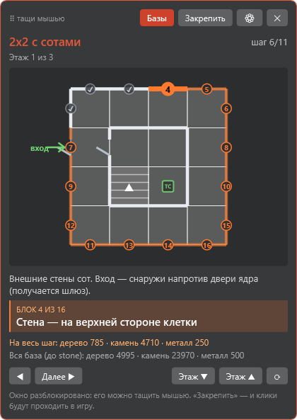
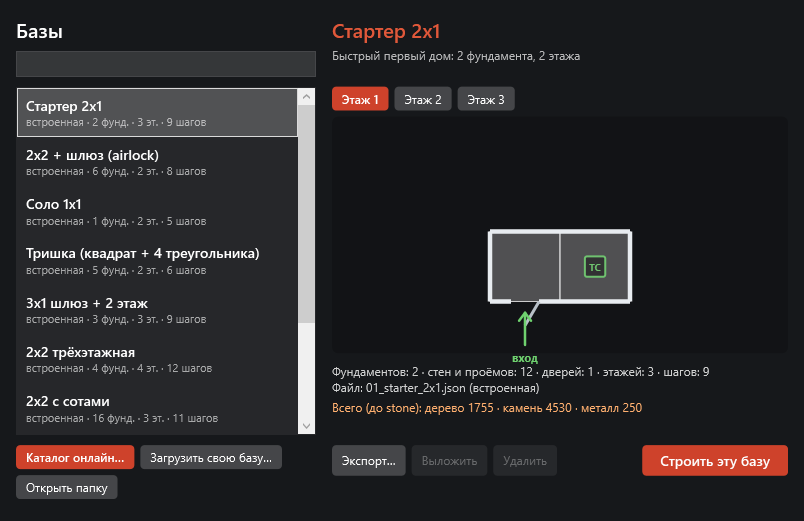

# RustBuilder

**Пошаговый гайд по строительству баз в Rust прямо поверх игры.**

Выбираешь базу, и RustBuilder показывает, что ставить: какой блок, на какую сторону, сколько ресурсов нужно. Переключаешь шаги горячими клавишами, не выходя из игры.

<p align="center">
  
</p>

> ✅ **RustBuilder не внедряется в игру.** Он не читает память Rust, не подгружает DLL и не нажимает клавиши за тебя. Это обычное окно поверх других окон, как оверлей Discord.

---

## Возможности

- 🧱 **Пошаговая схема по этажам.** Построенное закрашено цветом материала, текущий блок подсвечен оранжевым, будущие блоки показаны пунктиром.
- 🔢 **По одному блоку.** Все блоки шага пронумерованы, внизу написано словами, что ставить: *«Стена на верхней стороне клетки + металлическая дверь, кодовый замок»*.
- 🧭 **Ориентация.** Стрелка «вход» на схеме и поворот схемы на 90°, чтобы она совпала с тем, как ты стоишь в игре.
- 💰 **Ресурсы** на текущий шаг и на всю базу: дерево, камень, металл, МВК, шестерни.
- 📚 **Библиотека баз** с превью и поиском. В комплекте 10 готовых баз, от соло 1x1 до клановой 4x4 с сотами.
- 🌐 **Онлайн-каталог.** Скачивай базы других игроков и выкладывай свои в один клик (через GitHub).
- ⌨️ **Горячие клавиши работают прямо в игре**, их можно переназначить.
- 🖱️ **Режим «Закрепить».** Окно пропускает клики насквозь и не мешает играть.

<p align="center">
  
</p>

## Готовые базы

| База | Для кого |
|---|---|
| Соло 1x1 | самый быстрый старт |
| Стартер 2x1 | первый дом |
| Тришка (квадрат + 4 треугольника) | соло |
| 3x1 шлюз + 2 этаж | соло / дуо |
| 2x2 + шлюз | соло / дуо |
| 2x2 трёхэтажная | соло / дуо |
| 2x2 + стрелковая крыша | дуо |
| 2x2 с сотами | дуо, дорого рейдить |
| 3x3 для трио | 2–3 игрока |
| Клан 4x4 с сотами | клан |

## Установка

1. Установи [.NET 8 Desktop Runtime](https://dotnet.microsoft.com/download/dotnet/8.0) (Windows x64).
2. Скачай последний релиз из раздела **Releases** и распакуй.
3. Запусти `RustBuilder.exe`.
4. В Rust включи режим **«Окно без рамки»** (Borderless). В полноэкранном режиме оверлей не виден.

### Сборка из исходников

```bash
cd RustBuilder
dotnet build -c Release
```

Готовый `RustBuilder.exe` будет в `RustBuilder/bin/Release/net8.0-windows/`.

## Как пользоваться

1. При первом запуске откроется окно **«Базы»**. Выбери базу и нажми **«Строить эту базу»**.
2. Перетащи оверлей мышью в удобное место.
3. Нажми **«Закрепить»**. Теперь клики проходят в игру.
4. Строй и нажимай **Ctrl+Alt+→**, чтобы перейти к следующему блоку.

💡 **Совет:** встань снаружи лицом ко входу и поверни схему (**Ctrl+Alt+T**) так, чтобы стрелка «вход» была внизу. Тогда «левая/правая сторона» в подсказках совпадёт с тем, что ты видишь.

### Горячие клавиши по умолчанию

| Клавиши | Действие |
|---|---|
| `Ctrl+Alt+→` / `Ctrl+Alt+←` | следующий / предыдущий блок |
| `Ctrl+Alt+PgDn` / `Ctrl+Alt+PgUp` | следующий / предыдущий шаг целиком |
| `Ctrl+Alt+↑` / `Ctrl+Alt+↓` | этаж выше / ниже |
| `Ctrl+Alt+T` | повернуть схему |
| `Ctrl+Alt+B` | открыть базы |
| `Ctrl+Alt+S` | настройки |
| `Ctrl+Alt+H` | скрыть / показать оверлей |
| `Ctrl+Alt+L` | закрепить / разблокировать окно |
| `Ctrl+Alt+R` | перечитать файл базы |

Все клавиши, размер и прозрачность оверлея меняются в **Настройках** (⚙).

## Свои базы

База — это JSON-файл. Загрузить его можно через **«Базы» → «Загрузить свою базу…»**, а отправить другу через **«Экспорт…»**.

<details>
<summary><b>Формат файла базы</b></summary>

```jsonc
{
  "name": "Стартер 2x1",
  "description": "Быстрый первый дом",
  "tier": "stone",                       // twig | wood | stone | metal | hqm — до чего улучшать
  "pieces": [
    { "id": "f1", "type": "foundation", "x": 0, "y": 0 },          // квадрат на сетке
    { "id": "f2", "type": "foundation", "x": 1, "y": 0 },
    { "id": "t1", "type": "triangle", "on": "f1", "edge": "N" },   // треугольник к стороне квадрата
    { "id": "tc", "type": "tc", "on": "f2" },
    { "id": "w1", "type": "wall", "on": "f1", "edge": "W" },
    { "id": "d1", "type": "doorway", "on": "f1", "edge": "S",
      "door": "sheet", "lock": "code", "entrance": true },
    { "id": "s1", "type": "stairs", "on": "f2", "floor": 1 },
    { "id": "c1", "type": "floor", "on": "f1", "floor": 2 }        // перекрытие = пол 2-го этажа
  ],
  "steps": [
    { "text": "Поставь два фундамента.", "pieces": ["f1", "f2"] },
    { "text": "Шкаф.", "pieces": ["tc"] }
  ]
}
```

| Поле | Значения |
|---|---|
| `type` | `foundation`, `triangle`, `wall`, `doorway`, `window`, `halfwall`, `floor`, `stairs`, `tc` |
| `edge` | у квадрата `N` `E` `S` `W`, у треугольника `L` `R` (если смотреть от основания наружу) |
| `floor` | этаж: 1 — первый. У `floor` это уровень, на котором лежит перекрытие |
| `door` | `wood`, `sheet`, `armored` |
| `lock` | `code`, `key` |
| `entrance` | `true` — на схеме будет стрелка «вход» |

Большие базы удобнее описывать кодом в генераторе [`tools/gen-bases.mjs`](tools/gen-bases.mjs). Он сам считает внешние стены и раскладывает блоки по шагам.

</details>

## Онлайн-каталог

Каталог — это отдельный публичный репозиторий с папкой `bases/` и файлом `index.json`. Шаблон лежит в [`catalog-repo/`](catalog-repo).

- **Скачать:** «Базы» → «Каталог онлайн…» → «Скачать в мои базы». Аккаунт не нужен.
- **Выложить:** «Базы» → своя база → «Выложить». Откроется GitHub с готовым файлом. Останется нажать *Propose changes* и *Create pull request*.
- Каждая присланная база автоматически проверяется в GitHub Actions. В каталог она попадает после одобрения.

## Структура проекта

```
RustBuilder/     приложение (C#, .NET 8, WPF)
  Builds/        встроенные базы
tools/           генератор баз
catalog-repo/    шаблон репозитория онлайн-каталога
docs/            скриншоты для README
```

## Планы

- [ ] Визуальный редактор баз: собирать схему кликами по сетке
- [ ] Новые блоки: гаражные двери, люки, высокие стены
- [ ] Отметка «я уже поставил это» по распознаванию экрана

## Помочь проекту

Нашёл ошибку или неточную цену ресурсов? Открывай **Issue**. Хочешь добавить базу? Выложи её через приложение или пришли pull request в каталог.

---

<sub>RustBuilder — фанатский проект, он не связан с Facepunch Studios. Rust — торговая марка Facepunch Studios. Стоимость блоков примерная и может отличаться в текущей версии игры.</sub>
